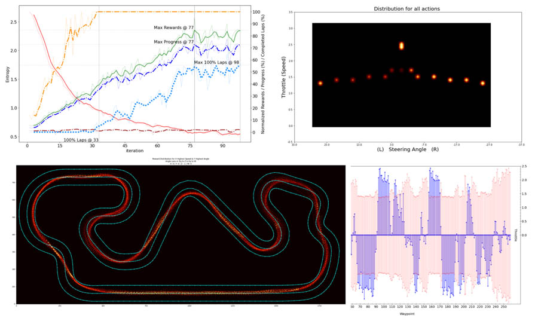

# Análise de Logs e Gráficos

No desenvolvimento de modelos de Aprendizagem por Reforço, chega um momento em que apenas observar o carro andando não é suficiente para entender o que o agente está fazendo de errado. Como vimos no módulo anterior, quando o desempenho do modelo cai ou deixa de melhorar, a solução não deve ser simplesmente alterar hiperparâmetros por tentativa e erro. É importante investigar o comportamento do agente e identificar possíveis causas para os resultados observados.

Para isso, utilizamos a ferramenta **DeepRacer Analysis**, desenvolvida e mantida pela AWS DeepRacer Community.

Essa ferramenta reúne Jupyter Notebooks que permitem analisar os registros de treinamento e avaliação do DeepRacer, transformando os dados em representações visuais que facilitam a investigação do desempenho dos modelos.

Com ela, é possível examinar métricas de treinamento, visualizar trajetórias e investigar aspectos do comportamento do veículo, conforme os dados disponíveis e o notebook utilizado.



## Por que analisar os logs?

Durante o treinamento, o agente realiza inúmeras interações com o ambiente. Observar apenas uma execução ou a recompensa acumulada não é suficiente para compreender todas as decisões que levaram ao resultado.

A análise dos logs ajuda a investigar perguntas como:

- O modelo está melhorando ao longo do treinamento?
- O aumento da recompensa corresponde a uma melhoria real no comportamento do veículo?
- Em quais regiões da pista o agente apresenta mais dificuldades?
- O modelo consegue completar a pista de maneira consistente?
- Uma alteração na função de recompensa produziu o efeito esperado?
- O desempenho observado durante o treinamento se mantém durante a avaliação?

Essas perguntas orientam a investigação e ajudam a transformar os dados coletados em hipóteses que podem ser testadas em novos experimentos.

!!! info "Nota conceitual"
    uma correlação entre determinada alteração e uma melhoria observada não comprova, por si só, que essa alteração foi a causa do resultado. O objetivo da análise é reunir evidências que permitam formular hipóteses melhores e conduzir comparações mais controladas.

## Conhecendo a ferramenta DeepRacer Analysis

O projeto está disponível publicamente no GitHub:

[Repositório da ferramenta DeepRacer Analysis](https://github.com/aws-deepracer-community/deepracer-analysis)

A ferramenta utiliza Python e Jupyter para processar os dados e gerar análises. O repositório disponibiliza diferentes notebooks, voltados a aspectos específicos do treinamento e da avaliação.

Entre os principais arquivos estão:

- **`Training_analysis.ipynb`**: análise dos registros e do desempenho durante o treinamento.
- **`Evaluation_analysis.ipynb`**: análise dos dados produzidos durante a avaliação dos modelos.
- **`Visual_Analysis.ipynb`**: recursos para investigação visual do comportamento do agente.
- **`ActionSpace_analysis.ipynb`**: análise relacionada ao espaço de ação do modelo.
- **`Metrics.ipynb`**: ferramentas de análise de métricas.

A disponibilidade e o funcionamento de cada análise dependem dos dados fornecidos, das dependências instaladas e da versão da ferramenta utilizada. Consulte o README do repositório antes de executar os notebooks.

## Obtendo os logs de treinamento e avaliação

O AWS DeepRacer passou por uma mudança importante em dezembro de 2025: o serviço gerenciado tradicional deixou de estar disponível no console da AWS, e a solução oficial passou a ser o DeepRacer on AWS, implantado na conta do usuário.

Por isso, os procedimentos de obtenção dos logs devem corresponder ao ambiente em que o modelo foi treinado.

### Opção 1: DeepRacer on AWS

Na solução oficial atual, é possível baixar os logs diretamente pela interface de gerenciamento dos modelos.

#### Logs de treinamento

1. Acesse a interface da sua implantação do DeepRacer on AWS.
2. Abra os detalhes do modelo que deseja analisar.
3. Localize a seção **Training**.
4. Clique em **Download logs**.
5. Salve os arquivos no computador e extraia o conteúdo, caso tenha sido disponibilizado em um arquivo compactado.

#### Logs de avaliação

1. Abra os detalhes do modelo correspondente.
2. Na seção de avaliações, selecione a avaliação desejada.
3. Clique em **Load evaluation**.
4. Localize a seção **Evaluation details**.
5. Clique em **Download logs** e salve os arquivos.

Esses procedimentos permitem obter registros de treinamento e avaliação sem depender do console antigo do DeepRacer.

Documentação oficial: [Troubleshooting the solution — DeepRacer on AWS](https://docs.aws.amazon.com/solutions/latest/deepracer-on-aws/troubleshooting-the-solution.html).

#### Organização dos arquivos

Antes de executar as análises, mantenha os arquivos de cada experimento organizados em diretórios separados. Isso reduz o risco de misturar registros de modelos diferentes.

Uma estrutura possível é:

```text
experimentos/
├── modelo_estabilidade/
│   ├── treinamento/
│   └── avaliacao/
├── modelo_velocidade/
│   ├── treinamento/
│   └── avaliacao/
└── modelo_obstaculos/
    ├── treinamento/
    └── avaliacao/
```

Essa estrutura é apenas uma sugestão para organizar os arquivos no computador. Os caminhos efetivamente utilizados devem ser configurados de acordo com as instruções do notebook selecionado.

### Opção 2: DeepRacer for Cloud (DRFC)

Se você estiver utilizando o [DeepRacer for Cloud](https://github.com/aws-deepracer-community/deepracer-for-cloud), os registros podem estar disponíveis no ambiente em que os modelos foram treinados.

Consulte a documentação da versão instalada para localizar os diretórios correspondentes aos modelos e identificar os arquivos necessários para a análise.

O repositório do DeepRacer Analysis também documenta uma integração com o DeepRacer for Cloud. Nessa configuração, o comando `dr-start-loganalysis` inicia o ambiente de análise disponibilizado pelo projeto.

Esse procedimento depende de uma instalação funcional do DRFC e da configuração correspondente. Ele não deve ser presumido como disponível em qualquer ambiente de treinamento.

## Como configurar e executar a ferramenta

A ferramenta pode ser executada em um ambiente local ou em um ambiente de Jupyter hospedado na nuvem. A escolha depende de como os logs serão acessados e dos recursos disponíveis.

Para começar, a execução local é uma alternativa prática quando os arquivos já foram baixados para o computador. Ela evita a necessidade de manter uma instância de análise separada na nuvem, embora exija a instalação das dependências e recursos computacionais locais adequados.

### Opção 1: Execução local com Python e JupyterLab

#### Pré-requisitos

Você precisará de:

- Python 3 compatível com as dependências da versão atual da ferramenta.
- Git instalado.
- Acesso ao terminal.
- Os logs do modelo que deseja analisar.
- Um ambiente com permissões para instalar as dependências necessárias.

O uso de um ambiente virtual Python é recomendado para isolar as bibliotecas da ferramenta das demais instalações do computador.

#### Passo a passo

**1. Clone o repositório**

Abra o terminal e execute:

```bash
git clone https://github.com/aws-deepracer-community/deepracer-analysis.git
cd deepracer-analysis
```

O comando `git clone` baixa os arquivos da ferramenta para o computador. O comando `cd` acessa a pasta criada.

**2. Crie um ambiente virtual**

No Linux ou macOS:

```bash
python3 -m venv .venv
source .venv/bin/activate
```

No Windows, utilizando o PowerShell:

```powershell
py -m venv .venv
.venv\Scripts\Activate.ps1
```

Se a ativação não funcionar, verifique as instruções do Python para o seu sistema operacional e as políticas de execução do terminal.

**3. Instale as dependências**

Com o ambiente virtual ativado, execute:

```bash
python -m pip install --upgrade pip
python -m pip install --upgrade -r requirements.txt
```

O arquivo `requirements.txt` contém as dependências definidas pelo projeto. Seguir esse arquivo é mais confiável do que instalar manualmente apenas algumas bibliotecas, pois a ferramenta pode depender de outros pacotes além de Pandas e Matplotlib.

Caso a instalação apresente erros, consulte o README do repositório e verifique a compatibilidade entre a versão do Python e as dependências exigidas.

**4. Inicie o JupyterLab**

Execute:

```bash
jupyter lab
```

O JupyterLab disponibiliza uma interface no navegador para abrir e executar os notebooks.

Se o comando não for reconhecido, verifique se o ambiente virtual está ativado e se a instalação das dependências foi concluída corretamente.

**5. Abra o notebook de análise**

Na interface do JupyterLab, navegue até a pasta do repositório e abra o notebook apropriado ao seu objetivo.

Para começar, utilize o `Training_analysis.ipynb` para investigar os dados de treinamento.

**6. Configure o acesso aos logs**

Siga as instruções do próprio notebook para indicar a origem dos dados.

Conforme a configuração utilizada, a ferramenta pode precisar de caminhos para arquivos locais ou de acesso aos registros armazenados na AWS.

!!! warning "Atenção aos requisitos do ambiente"
    Se o notebook buscar dados diretamente na AWS, será necessário ter o AWS CLI instalado e configurado, além de permissões compatíveis com os recursos acessados. A identidade utilizada precisa ter autorização para ler os objetos necessários no Amazon S3.

Se os logs já estiverem no computador, utilize os caminhos locais esperados pelo notebook. Não presuma que qualquer arquivo com a extensão `.log` será automaticamente reconhecido: o formato e a organização dos dados precisam ser compatíveis com a análise.

**7. Execute as células**

Execute as células do notebook na ordem apresentada, observando as mensagens retornadas durante a execução.

Quando uma célula apresentar erro, investigue sua causa antes de prosseguir. Problemas podem estar relacionados a caminhos incorretos, dependências incompatíveis, permissões de acesso ou formatos de dados diferentes dos esperados.

### Opção 2: Execução em um ambiente Jupyter hospedado na AWS

Executar a análise em um ambiente hospedado na AWS pode ser útil quando os dados já estão armazenados no Amazon S3 ou quando o ambiente local não possui recursos suficientes.

A configuração exata depende do ambiente Jupyter disponível. O procedimento abaixo pressupõe que você já tenha acesso a um ambiente de execução compatível, como uma instância de análise previamente configurada.

**1. Verifique o acesso aos logs**

Confirme se os registros necessários estão disponíveis no Amazon S3 ou se você precisará carregá-los a partir de arquivos baixados.

Na solução oficial DeepRacer on AWS, os arquivos gerados durante o treinamento e a avaliação são armazenados em recursos da implantação. O método mais direto para obter os registros é utilizar os recursos de download da interface do modelo.

**2. Configure as permissões**

Se o notebook precisar ler os arquivos diretamente no S3, a identidade utilizada pela sessão deverá ter as permissões necessárias para acessar os objetos correspondentes.

Em um ambiente hospedado na AWS, isso pode depender da função IAM associada ao ambiente e das políticas aplicadas à conta. A configuração deve seguir o princípio do menor privilégio: conceda somente as permissões necessárias para a análise.

**3. Prepare a ferramenta**

No terminal do ambiente Jupyter, clone o repositório e instale as dependências conforme as instruções da versão utilizada.

```bash
git clone https://github.com/aws-deepracer-community/deepracer-analysis.git
cd deepracer-analysis
python -m pip install --upgrade -r requirements.txt
```

Caso o ambiente utilize uma estrutura própria de gerenciamento de dependências, siga os procedimentos adotados por ele.

**4. Abra e configure o notebook**

Abra o `Training_analysis.ipynb`, configure a origem dos logs conforme as instruções fornecidas pelo projeto e execute as células.

**5. Encerre os recursos que não serão mais utilizados**

O uso de recursos computacionais hospedados pode gerar custos, conforme o serviço, o tipo de recurso e o tempo de execução.

Ao terminar, encerre ou interrompa os recursos de análise que não precisarão permanecer ativos. Se a infraestrutura tiver sido criada especificamente para esse trabalho, verifique também quais recursos devem ser removidos para evitar custos desnecessários.

**Observação:** a análise dos logs não exige necessariamente a criação de uma nova instância do SageMaker. Utilize o ambiente de execução compatível que estiver disponível e avalie os custos e requisitos antes de provisionar infraestrutura adicional.

## Como interpretar os resultados

Após executar os notebooks, o próximo passo é interpretar os dados. Os gráficos não devem ser vistos apenas como representações do treinamento, mas como ferramentas para investigar o comportamento do modelo.

A interpretação deve considerar o objetivo do experimento, as métricas disponíveis e as condições em que os dados foram coletados.

### 1. Evolução da recompensa

A evolução da recompensa ajuda a observar como o sinal recebido pelo agente varia durante o treinamento.

Uma tendência crescente pode indicar que o modelo está aprendendo comportamentos favorecidos pela função de recompensa. Entretanto, isso não garante que o agente esteja dirigindo melhor.

Por exemplo, se a função de recompensa favorecer excessivamente a velocidade, o modelo poderá aumentar sua pontuação mesmo sem melhorar a consistência das voltas.

Por isso, interprete a curva em conjunto com outras evidências, como o progresso na pista, as saídas do percurso e os resultados da avaliação.

### 2. Trajetória do veículo

Os recursos de análise visual podem ajudar a identificar regiões em que o modelo apresenta dificuldades.

Observe se o veículo:

- Sai repetidamente da pista em determinada curva.
- Apresenta movimentos excessivamente oscilantes.
- Mantém uma trajetória inadequada em determinados trechos.
- Tem dificuldades para contornar obstáculos, quando a modalidade e os dados utilizados permitem essa análise.

A trajetória fornece evidências sobre o comportamento do agente, mas não explica automaticamente a causa de um problema. A investigação precisa considerar também a função de recompensa, o espaço de ação, os sensores utilizados e as condições de treinamento.

### 3. Velocidade e controle

Quando os registros e as ferramentas utilizadas disponibilizarem informações adequadas, examine a relação entre velocidade, direção e comportamento na pista.

Um veículo que apresenta alta velocidade em retas, mas perde o controle repetidamente nas curvas, pode estar sendo incentivado a priorizar a velocidade sem considerar suficientemente as consequências dessa escolha.

Antes de alterar a função de recompensa, verifique se os dados sustentam essa hipótese. Em seguida, conduza um experimento controlado para investigar o efeito da mudança.

### 4. Consistência do desempenho

Uma execução bem-sucedida não garante que o modelo seja consistente.

Compare os resultados de diferentes avaliações e observe se o comportamento se mantém ao longo de várias tentativas. Quando possível, considere o percentual de conclusão da pista, o tempo de volta e a frequência de comportamentos indesejados.

A comparação precisa ser feita sob condições equivalentes. Diferenças nas pistas, nas modalidades, nas configurações ou nos procedimentos de avaliação podem dificultar a interpretação dos resultados.

### 5. Estagnação ou oscilação do treinamento

Um modelo pode deixar de apresentar melhorias claras ou mostrar grandes oscilações nas métricas.

Esses comportamentos não possuem uma causa única. Podem estar relacionados à função de recompensa, à exploração, aos hiperparâmetros, à variabilidade das experiências ou às limitações do espaço de ação.

Evite concluir que determinado parâmetro é o responsável apenas com base em uma curva. Procure outras evidências nos logs e, sempre que possível, teste uma hipótese por vez.

## Estratégia prática de diagnóstico

Quando os resultados não corresponderem ao esperado, utilize a análise como parte de um ciclo de investigação.

1. **Identifique o problema:** descreva o comportamento observado, como saídas recorrentes da pista ou ausência de melhoria no desempenho.
2. **Examine os dados:** consulte os gráficos e os registros disponíveis para localizar situações associadas ao problema.
3. **Formule uma hipótese:** procure explicar como a função de recompensa, o espaço de ação ou outra configuração pode contribuir para o comportamento.
4. **Escolha uma alteração:** modifique o componente mais diretamente relacionado à hipótese.
5. **Repita o treinamento ou a avaliação:** utilize condições comparáveis para observar o efeito da alteração.
6. **Registre a conclusão:** documente o resultado e verifique se as evidências apoiam ou contradizem a hipótese.

!!! tip "Dica de experimentação"
    Essa abordagem diminui a dependência de ajustes aleatórios e torna o processo de otimização mais consistente.

Por exemplo, se o veículo sai repetidamente da pista em curvas, uma possível hipótese é que a função de recompensa esteja incentivando a velocidade sem considerar adequadamente o controle do veículo. A análise dos registros pode ajudar a investigar essa possibilidade.

Após formular a hipótese, altere a função de recompensa ou outra configuração pertinente, treine uma nova versão do modelo e compare os resultados. Se o comportamento não melhorar, será necessário reconsiderar a hipótese e investigar outras causas.

## Cuidados e limitações

Antes de tirar conclusões a partir dos gráficos, considere alguns cuidados.

**A recompensa não é uma medida universal de qualidade.** Ela representa o objetivo numérico estabelecido pela função de recompensa. Um valor maior não garante, isoladamente, um comportamento melhor.

**Os registros dependem do ambiente utilizado.** A estrutura dos arquivos, os parâmetros disponíveis e as métricas registradas podem variar conforme a implementação do DeepRacer e a versão da ferramenta.

**Os gráficos não identificam automaticamente a causa de um problema.** Eles ajudam a localizar comportamentos e formular hipóteses, mas as conclusões precisam ser verificadas por meio de novos experimentos.

**Os logs de treinamento não são os mesmos que os logs operacionais da infraestrutura.** No DeepRacer on AWS, os registros de treinamento e avaliação podem ser baixados pela interface do modelo. Já os logs do Amazon CloudWatch podem auxiliar na investigação de erros de serviços e componentes da implantação. Cada tipo de registro serve a uma finalidade diferente.

**Proteja os dados e as credenciais.** Não inclua chaves de acesso da AWS, arquivos de configuração com credenciais ou outros segredos no repositório público do projeto. Antes de publicar logs ou artefatos, verifique se não contêm informações que não devem ser compartilhadas.

## Referências oficiais e recursos

- [Repositório DeepRacer Analysis — AWS DeepRacer Community](https://github.com/aws-deepracer-community/deepracer-analysis)
- [DeepRacer on AWS — Solução oficial](https://docs.aws.amazon.com/solutions/latest/deepracer-on-aws/)
- [Troubleshooting the solution — DeepRacer on AWS](https://docs.aws.amazon.com/solutions/latest/deepracer-on-aws/troubleshooting-the-solution.html)
- [DeepRacer for Cloud — Repositório da comunidade](https://github.com/aws-deepracer-community/deepracer-for-cloud)

## Próxima etapa

[Desafios Práticos](desafios.md)