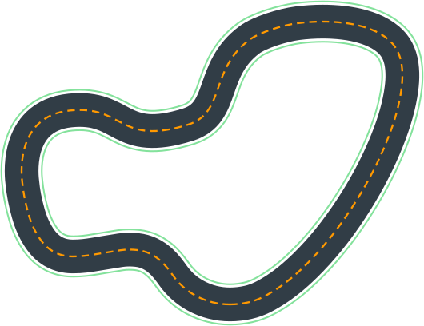
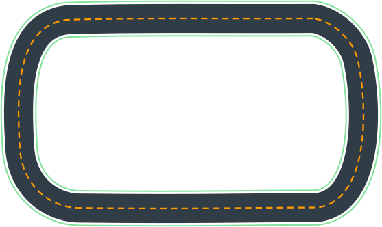
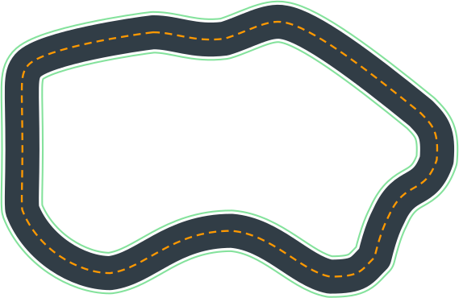

# Desafios Práticos

Este módulo reúne quatro desafios para aplicar os conceitos apresentados ao longo do guia. A sequência começa com a conclusão consistente de uma pista, avança para o desvio de obstáculos, explora um segundo algoritmo de aprendizado e termina com a otimização do desempenho de um modelo.

O objetivo não é apenas treinar um carro que complete uma volta. Você deverá formular funções de recompensa, analisar o comportamento aprendido, interpretar os resultados e justificar as alterações realizadas.

## Antes de começar

### Requisitos

Antes de iniciar os desafios, verifique se você possui:

- Um ambiente funcional de treinamento do AWS DeepRacer ou uma implementação comunitária compatível.
- Conhecimentos básicos de Python para desenvolver funções de recompensa.
- Familiaridade com os conceitos de Aprendizagem por Reforço apresentados nos módulos anteriores.
- Acesso aos logs ou às métricas necessários para avaliar os modelos.

!!! warning "Atenção aos requisitos do ambiente"
    A configuração exata dos algoritmos, sensores, modalidades e espaços de ação depende do ambiente utilizado. Consulte a documentação correspondente antes de iniciar cada experimento.

A solução oficial [DeepRacer on AWS](https://docs.aws.amazon.com/solutions/latest/deepracer-on-aws/) disponibiliza as modalidades Time Trial e Object Avoidance. Ela também oferece PPO e SAC, mas com restrições diferentes de compatibilidade com os espaços de ação.

O PPO pode ser utilizado com espaços de ação discretos ou contínuos. O SAC utiliza espaço de ação contínuo na implementação oficial. Por isso, as configurações de cada desafio foram organizadas para evitar combinações incompatíveis.

Se você utilizar o [DeepRacer for Cloud (DRFC)](https://github.com/aws-deepracer-community/deepracer-for-cloud), confira a documentação da versão instalada antes de reproduzir os experimentos. Algumas modalidades e recursos da comunidade não correspondem exatamente aos disponíveis na solução oficial.

### Sobre o tempo de treinamento

As durações indicadas em cada desafio são **orçamentos sugeridos de treinamento**, e não garantias de que o modelo alcançará o resultado esperado naquele período.

O tempo necessário depende dos recursos computacionais, da velocidade de coleta de experiências, da complexidade do ambiente e das configurações utilizadas.

Se o modelo não atingir os critérios de avaliação dentro do orçamento disponível, registre o resultado e investigue as possíveis causas. Não considere um modelo bem-sucedido apenas porque o tempo previsto terminou.

### Protocolo de avaliação

Para que os resultados sejam comparáveis, utilize um procedimento consistente ao longo dos desafios.

1. **Registre a configuração:** anote o algoritmo, o espaço de ação, os sensores, a pista, a função de recompensa e os principais hiperparâmetros utilizados.
2. **Avalie o comportamento:** observe se o carro completa a pista, sai dos limites, colide com objetos ou apresenta movimentos instáveis.
3. **Utilize métricas compatíveis com o objetivo:** considere taxa de conclusão, tempo de volta, colisões e outras métricas disponíveis no ambiente.
4. **Compare condições equivalentes:** mantenha a mesma pista, modalidade e procedimento de avaliação ao comparar modelos.
5. **Documente as alterações:** registre o que foi modificado, por que a alteração foi realizada e quais resultados foram observados.

!!! tip "Dica de experimentação"
    Sempre que o ambiente permitir, utilize dez tentativas de avaliação por modelo. Caso isso não seja possível, escolha uma quantidade consistente e registre o número de tentativas realizadas.

Os critérios definidos abaixo são metas didáticas para orientar os exercícios. Eles não representam resultados já alcançados nem garantem que um modelo conseguirá atingi-los.

---

## Desafio 1: Conclusão consistente da pista

Neste primeiro desafio, o objetivo é fazer um carro que consiga completar a pista de maneira consistente. O foco inicial não é a velocidade, mas a capacidade de permanecer no percurso e concluir a volta.

Você deverá desenvolver uma função de recompensa simples que incentive comportamentos compatíveis com esse objetivo.

### Configuração sugerida

| Aspecto | Configuração |
|---|---|
| **Objetivo** | Criar um modelo que complete a pista de forma consistente |
| **Orçamento de treinamento** | Até 1 hora |
| **Espaço de ação** | Discreto |
| **Algoritmo de aprendizado** | PPO |
| **Hiperparâmetros** | Configuração inicial padrão disponível no ambiente |
| **Tipo de corrida** | Time Trial (Tomada de Tempo) |
| **Câmeras e sensores** | Câmera frontal única |
| **Pista** | Smile Speedway |

Utilize as configurações disponíveis no ambiente escolhido. Caso a pista Smile Speedway ou algum parâmetro indicado não esteja disponível, selecione uma alternativa compatível e registre a mudança.

### O que você deverá fazer

1. Configure um modelo PPO com espaço de ação discreto.
2. Desenvolva uma função de recompensa que priorize a permanência do veículo na pista e o progresso ao longo do percurso.
3. Evite incentivar a velocidade excessivamente nesta etapa.
4. Treine o modelo dentro do orçamento disponível.
5. Avalie o comportamento do agente e examine os gráficos e logs de treinamento.
6. Identifique os trechos em que o modelo apresenta dificuldades e formule hipóteses sobre suas causas.

Não é necessário desenvolver uma função de recompensa complexa. O objetivo é compreender como uma definição simples de incentivos influencia o comportamento do agente.

### Critérios de avaliação

Considere o desafio concluído quando:

- O modelo completar a pista em pelo menos 8 de 10 tentativas de avaliação, quando essa quantidade de tentativas estiver disponível.
- O veículo apresentar um comportamento suficientemente consistente para que o resultado não dependa apenas de uma volta bem-sucedida.
- Você conseguir identificar, por meio da análise dos dados disponíveis, pelo menos uma situação em que o modelo apresenta dificuldades ou uma limitação que ainda precisa ser investigada.

Se o modelo não atingir a meta de conclusão, registre a taxa observada e investigue as possíveis causas. A ausência de sucesso dentro do tempo disponível também é um resultado útil quando acompanhada de uma análise fundamentada.

### Análise de logs — etapa obrigatória

Utilize a ferramenta [DeepRacer Analysis](https://github.com/aws-deepracer-community/deepracer-analysis), desde que os dados gerados pelo seu ambiente sejam compatíveis com ela.

Investigue:

- A evolução da recompensa durante o treinamento.
- As regiões em que o veículo sai da pista ou apresenta dificuldades.
- A relação entre a recompensa recebida e o comportamento observado.
- As possíveis modificações que poderiam contribuir para melhorar a consistência.

A recompensa crescente não garante, isoladamente, que o modelo esteja dirigindo melhor. Compare os gráficos com o resultado efetivo das avaliações.

### Reflexão final

Registre suas respostas:

1. O modelo conseguiu completar a pista de maneira consistente?
2. Em quais situações o veículo apresentou mais dificuldades?
3. A função de recompensa favoreceu o comportamento desejado?
4. Qual alteração você investigaria no próximo experimento?

**Entrega esperada:** um modelo treinado, a função de recompensa utilizada, os resultados da avaliação e uma breve análise das principais dificuldades observadas.

---

## Desafio 2: Desvio de obstáculos

Agora a dificuldade aumenta. Além de completar a pista, o carro precisa aprender a desviar de objetos sem comprometer excessivamente sua capacidade de concluir o percurso.

Esse desafio introduz a modalidade Object Avoidance e permite investigar como os sensores influenciam as informações disponíveis para o agente.

### Configuração sugerida

| Aspecto | Configuração |
|---|---|
| **Objetivo** | Treinar um modelo capaz de completar a pista e evitar obstáculos |
| **Orçamento de treinamento** | Até 2 horas |
| **Espaço de ação** | Discreto |
| **Algoritmo de aprendizado** | PPO |
| **Hiperparâmetros** | Configuração inicial padrão do PPO |
| **Tipo de corrida** | Object Avoidance (Desvio de Obstáculos) |
| **Câmeras e sensores** | Câmera estéreo frontal |
| **Pista** | Oval Track |
| **Posicionamento inicial dos objetos** | Posições fixas, quando disponível |

Começar com objetos em posições fixas ajuda a reduzir a complexidade inicial do exercício. Após obter um comportamento razoável nesse cenário, você poderá investigar como o modelo se comporta quando a posição dos objetos varia.

Caso a pista Oval Track não esteja disponível no ambiente escolhido, utilize uma pista compatível com a modalidade e registre qual foi utilizada.

### O que você deverá fazer

1. Configure um modelo PPO com espaço de ação discreto e câmera estéreo.
2. Selecione a modalidade Object Avoidance e defina os objetos conforme as opções disponíveis.
3. Desenvolva ou adapte a função de recompensa para favorecer a conclusão do percurso sem colisões.
4. Treine o modelo e observe como ele se comporta ao se aproximar dos obstáculos.
5. Avalie a taxa de conclusão, as colisões e o tempo de volta.
6. Utilize os logs e as avaliações para identificar situações em que o modelo ainda apresenta dificuldades.

A função de recompensa deverá considerar o objetivo de evitar obstáculos, mas não deve ser projetada apenas para maximizar uma pontuação numérica. Verifique se o agente realmente consegue concluir o percurso com um comportamento consistente.

### Sobre câmeras estéreo e câmera única

A câmera estéreo utiliza imagens capturadas por duas lentes para fornecer informações que ajudam a estimar a profundidade dos objetos. Isso pode ser útil em cenários nos quais o agente precisa avaliar a posição de obstáculos.

A câmera frontal única, por sua vez, fornece informações visuais sem a mesma representação estéreo de profundidade. Ela pode ser suficiente para algumas situações mais simples, incluindo obstáculos em posições fixas, mas pode apresentar limitações quando o posicionamento dos objetos varia.

A câmera estéreo também pode aumentar a complexidade do treinamento. Portanto, não presuma que ela produzirá necessariamente um modelo superior em todas as condições.

### Experimento comparativo recomendado

Para investigar o efeito dos sensores, crie uma segunda configuração com câmera frontal única.

Mantenha, tanto quanto possível, as mesmas condições:

- Pista e modalidade.
- Posições dos obstáculos.
- Espaço de ação e algoritmo.
- Função de recompensa.
- Orçamento de treinamento.
- Quantidade de tentativas de avaliação.

Compare os resultados das duas configurações. Observe se há diferenças na taxa de conclusão, nas colisões e no tempo de volta.

Essa comparação não demonstrará, por si só, que um tipo de sensor é sempre superior ao outro. Ela permitirá avaliar o comportamento das duas configurações nas condições específicas do experimento.

### Critérios de avaliação

Considere o desafio concluído quando:

- O modelo completar a pista sem colisões em pelo menos 7 de 10 tentativas de avaliação, quando essa quantidade estiver disponível.
- Você conseguir identificar situações em que o agente apresenta dificuldades para contornar os obstáculos.
- A análise dos dados permitir descrever pelo menos uma diferença relevante entre a configuração testada e uma referência de comparação, quando o experimento comparativo for realizado.

Caso a meta não seja alcançada, registre os resultados observados e investigue se as dificuldades estão relacionadas à função de recompensa, à configuração dos sensores, ao espaço de ação ou às limitações do treinamento.

### Extensão opcional: obstáculos em posições aleatórias

Depois de testar as posições fixas, altere o cenário para utilizar objetos em posições aleatórias, caso o ambiente ofereça essa opção.

Essa extensão ajuda a investigar se o agente aprendeu um comportamento útil para evitar obstáculos ou se o desempenho depende excessivamente das posições encontradas durante o treinamento.

Avalie o modelo em condições diferentes das utilizadas inicialmente e registre as diferenças observadas. Não presuma que um resultado positivo com posições fixas será reproduzido no cenário aleatório.

### Reflexão final

1. O modelo conseguiu completar a pista sem colidir com os objetos?
2. Quais situações provocaram mais dificuldades?
3. A configuração de sensores influenciou o comportamento observado?
4. O modelo manteve o desempenho quando a posição dos obstáculos mudou?

**Entrega esperada:** modelo treinado, função de recompensa, configuração dos sensores, resultados da avaliação e análise do comportamento ao redor dos obstáculos.

---

## Desafio 3: Experimentando o SAC

Neste desafio, você utilizará o algoritmo SAC (Soft Actor-Critic) para investigar como uma estratégia de aprendizado diferente influencia o comportamento do agente.

Ao contrário do PPO, o SAC utiliza experiências anteriores por meio de um *replay buffer* e incorpora a entropia ao objetivo de otimização. Essas características influenciam a maneira como o algoritmo aprende e explora o espaço de ação.

Na solução oficial DeepRacer on AWS, o SAC utiliza espaço de ação contínuo. Por isso, este exercício utiliza uma configuração compatível e uma modalidade de Time Trial, permitindo concentrar a investigação no treinamento e no comportamento do modelo.

### Configuração sugerida

| Aspecto | Configuração |
|---|---|
| **Objetivo** | Investigar o comportamento do SAC com espaço de ação contínuo |
| **Orçamento de treinamento** | Até 2 horas por modelo |
| **Espaço de ação** | Contínuo |
| **Algoritmo de aprendizado** | SAC |
| **Hiperparâmetros** | Configuração inicial padrão disponível para SAC |
| **Tipo de corrida** | Time Trial (Tomada de Tempo) |
| **Câmeras e sensores** | Câmera frontal única |
| **Pista** | London Loop Training |

Se a pista London Loop Training não estiver disponível na implementação escolhida, utilize outra pista compatível com Time Trial e registre a substituição.

### O que você deverá fazer

1. Configure um modelo SAC com espaço de ação contínuo.
2. Defina intervalos adequados para os ângulos de direção e as velocidades disponíveis.
3. Desenvolva uma função de recompensa coerente com o objetivo de completar a pista.
4. Treine o modelo dentro do orçamento disponível.
5. Avalie o comportamento do veículo e investigue como ele utiliza as ações contínuas.
6. Examine as métricas e os logs disponíveis para compreender a evolução do treinamento.

O espaço de ação contínuo permite selecionar valores dentro de intervalos definidos, mas isso não garante um desempenho superior ao de um espaço discreto. O resultado dependerá da configuração do modelo, da função de recompensa e das experiências coletadas.

### Comparação com PPO

Para entender melhor as diferenças entre os algoritmos, realize um experimento comparativo com PPO.

Crie uma configuração PPO com espaço de ação contínuo e mantenha as seguintes condições iguais às do modelo SAC:

- Pista e modalidade.
- Sensores utilizados.
- Intervalos de velocidade e direção.
- Função de recompensa.
- Orçamento de treinamento.
- Procedimento e quantidade de tentativas de avaliação.

Altere apenas o algoritmo entre os dois experimentos, mantendo os demais fatores tão próximos quanto possível.

!!! info "Nota conceitual"
    o modelo PPO discreto do Desafio 1 não deve ser utilizado como comparação direta para isolar o efeito do algoritmo, pois o espaço de ação também seria diferente. Para realizar uma comparação mais controlada, utilize PPO contínuo como referência.

### Critérios de avaliação

Considere o desafio concluído quando:

- O treinamento e a avaliação dos modelos tiverem sido realizados ou quando as limitações que impediram sua conclusão estiverem documentadas.
- Você tiver registrado os parâmetros e as condições de cada experimento.
- A comparação incluir métricas compatíveis, como taxa de conclusão, tempo de volta e frequência de saídas da pista.
- Você conseguir explicar pelo menos uma diferença observada entre os resultados ou identificar quais evidências seriam necessárias para tirar uma conclusão mais segura.

Não é obrigatório que o SAC supere o PPO. O objetivo é compreender as diferenças entre os algoritmos e avaliar seu comportamento experimentalmente, e não confirmar antecipadamente que um deles será superior.

### Extensão opcional: corrida contra um oponente

A modalidade Head-to-Head não está disponível como tipo de corrida na solução oficial DeepRacer on AWS documentada neste guia.

Se estiver utilizando o DeepRacer for Cloud, você poderá investigar a modalidade comunitária Head-to-Bot, desde que a versão instalada ofereça o recurso e sua configuração seja compatível com o objetivo do experimento.

Essa extensão deve ser tratada separadamente do desafio principal, pois muda a modalidade e pode introduzir diferenças adicionais no comportamento do ambiente. Não considere Head-to-Bot automaticamente equivalente a uma modalidade Head-to-Head de outra implementação.

### Reflexão final

1. O modelo SAC apresentou um comportamento diferente durante o treinamento?
2. Quais diferenças foram observadas na taxa de conclusão e no tempo de volta?
3. O resultado da comparação foi consistente ou variou entre as tentativas?
4. As evidências obtidas permitem atribuir a diferença ao algoritmo ou existem outras variáveis que precisam ser investigadas?

**Entrega esperada:** modelo SAC treinado, função de recompensa, registro da configuração e análise dos resultados. Se o experimento com PPO for realizado, inclua também a comparação entre os dois algoritmos.

---

## Desafio 4: Otimização final

Este é o desafio final. Você deverá partir de um modelo que já apresente um comportamento razoavelmente consistente e investigar como melhorar seu desempenho sem comprometer a capacidade de completar a pista.

O foco passa a ser a otimização. Você poderá explorar alterações na função de recompensa, na velocidade máxima, nos hiperparâmetros e, quando apropriado, em outros aspectos da configuração.

O objetivo não é simplesmente produzir o menor tempo de volta em uma tentativa isolada, mas encontrar um modelo que apresente uma melhoria mensurável e mantenha um nível aceitável de consistência.

### Configuração sugerida

| Aspecto | Configuração |
|---|---|
| **Objetivo** | Melhorar o desempenho de um modelo sem comprometer excessivamente sua consistência |
| **Orçamento de treinamento** | Até 4 horas |
| **Espaço de ação** | O mesmo do modelo de referência |
| **Algoritmo de aprendizado** | O mesmo do modelo de referência |
| **Hiperparâmetros** | Ajustados de acordo com a hipótese do experimento |
| **Tipo de corrida** | A mesma do modelo de referência |
| **Câmeras e sensores** | Os mesmos do modelo de referência |
| **Pista** | A mesma do modelo de referência |

### Escolha do modelo de referência

Utilize um modelo desenvolvido anteriormente que tenha apresentado resultados satisfatórios na avaliação.

O modelo de referência deve possuir uma configuração compatível com a abordagem de continuação do treinamento que você pretende utilizar.

Antes de cloná-lo, verifique quais parâmetros e artefatos serão preservados pela implementação escolhida.

**Não presuma que um modelo pode ser clonado e continuar o treinamento com qualquer combinação de algoritmo e espaço de ação.** Se desejar mudar de PPO para SAC, ou de espaço discreto para contínuo, verifique a compatibilidade da implementação e considere criar um modelo separado, quando necessário.

Para investigar o efeito de uma alteração específica, mantenha o algoritmo, a modalidade, os sensores e o espaço de ação do modelo de referência.

### O que você deverá fazer

1. Escolha um modelo de referência e registre seus resultados.
2. Identifique uma oportunidade de melhoria, como reduzir o tempo de volta sem aumentar excessivamente as saídas da pista.
3. Formule uma hipótese sobre a possível causa da limitação.
4. Escolha uma alteração coerente com essa hipótese.
5. Clone o modelo, quando a implementação permitir a continuação do treinamento, ou prepare uma configuração compatível.
6. Realize o treinamento dentro do orçamento disponível.
7. Avalie a nova versão sob as mesmas condições utilizadas para o modelo de referência.
8. Compare as métricas e registre a conclusão.

Evite alterar vários parâmetros simultaneamente. Se você modificar a função de recompensa, o espaço de ação e os hiperparâmetros ao mesmo tempo, será mais difícil identificar qual alteração contribuiu para o resultado.

### Critérios de avaliação

Utilize o seguinte objetivo como referência didática:

- Reduzir em pelo menos 5% a mediana do tempo de volta em relação ao modelo de referência.
- Manter a taxa de conclusão da pista, admitindo no máximo uma tentativa concluída a menos em cada conjunto de dez avaliações.
- Não apresentar um aumento relevante nos comportamentos indesejados, como saídas da pista ou colisões.
- Documentar a configuração original, a alteração realizada e os resultados obtidos.

A meta de redução de 5% é um critério didático proposto para este desafio, e não uma expectativa garantida de melhoria. Ela também só é aplicável quando o modelo de referência permite medir tempos de volta comparáveis.

Caso a configuração inicial não consiga completar o percurso de maneira consistente, priorize primeiro a estabilidade. Não faz sentido otimizar a velocidade de um modelo que ainda não apresenta uma taxa de conclusão adequada.

Se a meta não for alcançada, registre a diferença observada e explique o que os dados permitem concluir. Um experimento que não melhora o resultado ainda pode ser útil quando ajuda a descartar uma hipótese ou identificar uma limitação do modelo.

### Aviso sobre espaço de ação contínuo

O espaço de ação contínuo oferece mais flexibilidade na seleção de velocidade e direção, mas pode exigir mais tempo e experimentação para alcançar um comportamento satisfatório.

O desempenho depende dos intervalos definidos, do algoritmo, da função de recompensa e das condições de treinamento. Não é correto afirmar que o espaço contínuo sempre converge mais lentamente em todos os cenários, mas ele pode tornar a busca por boas combinações de ações mais exigente.

Se o modelo de referência utilizar espaço discreto, preserve essa configuração durante a primeira rodada de otimização. Caso deseje testar espaço contínuo, trate a mudança como um experimento separado e utilize um modelo compatível.

### Reflexão final

1. Qual era a principal limitação do modelo de referência?
2. Qual hipótese orientou a otimização?
3. A alteração melhorou a mediana do tempo de volta?
4. A taxa de conclusão foi mantida?
5. Os resultados foram consistentes entre as avaliações?
6. O que você faria de diferente em uma próxima versão?

**Entrega esperada:** modelo otimizado ou experimento documentado, comparação com a referência e análise crítica dos resultados, incluindo as alterações realizadas e suas limitações.

---

## Encerramento dos desafios

Ao concluir os quatro desafios, você terá percorrido um processo de experimentação que parte da construção de um comportamento básico e avança para a análise de obstáculos, a comparação de algoritmos e a otimização de desempenho.

Mais importante do que obter um modelo com uma pontuação elevada é compreender por que ele apresenta determinado comportamento e quais evidências sustentam suas conclusões.

Ao longo dos experimentos, mantenha o registro das configurações, das hipóteses, das métricas e dos resultados. Essa prática permite comparar versões, identificar limitações e tornar o processo de desenvolvimento mais reproduzível.

Os resultados obtidos devem ser interpretados de acordo com as condições em que os experimentos foram realizados. Um modelo bem-sucedido em uma pista ou configuração não garante desempenho equivalente em outros ambientes.

A principal competência desenvolvida neste percurso é a capacidade de investigar sistematicamente o comportamento de um agente, conectar os conceitos teóricos aos resultados observados e utilizar evidências para orientar as próximas decisões.

## Referências e documentação

- [DeepRacer on AWS — Documentação oficial](https://docs.aws.amazon.com/solutions/latest/deepracer-on-aws/)
- [Criação de modelos e configuração de sensores](https://docs.aws.amazon.com/solutions/latest/deepracer-on-aws/create-a-model.html)
- [Algoritmos de treinamento](https://docs.aws.amazon.com/solutions/latest/deepracer-on-aws/training-algorithms.html)
- [Espaço de ação e função de recompensa](https://docs.aws.amazon.com/solutions/latest/deepracer-on-aws/action-space-reward-function.html)
- [DeepRacer Analysis — Ferramenta de análise de logs](https://github.com/aws-deepracer-community/deepracer-analysis)
- [DeepRacer for Cloud — Ambiente comunitário](https://github.com/aws-deepracer-community/deepracer-for-cloud)