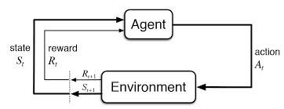

# Conceitos Fundamentais de Aprendizagem por Reforço no DeepRacer

## Aprendizagem por Reforço

A Aprendizagem por Reforço (RL — Reinforcement Learning) é uma abordagem do aprendizado de máquina na qual um agente aprende a tomar decisões por meio da interação com um ambiente, buscando maximizar uma recompensa cumulativa ao longo do tempo.

O processo ocorre por tentativa e erro. O agente experimenta ações, observa as consequências e utiliza as experiências obtidas para melhorar sua estratégia de decisão.

Diferentemente da programação tradicional, não é necessário definir explicitamente cada ação que o agente deverá executar em todas as situações. Em vez disso, especificamos um objetivo por meio de recompensas, e o algoritmo procura aprender uma política que favoreça esse objetivo.

No DeepRacer, podemos buscar um modelo capaz de completar uma pista de maneira consistente e, posteriormente, investigar como melhorar seu desempenho. Para isso, podemos incentivar comportamentos como permanecer dentro dos limites da pista e progredir ao longo do percurso.

Entretanto, o agente não aprende necessariamente a dirigir bem apenas porque recebe recompensas. Ele aprende a maximizar o objetivo matemático definido pela função de recompensa. Se os incentivos não representarem adequadamente o comportamento desejado, o modelo poderá desenvolver estratégias que aumentem a pontuação sem produzir o resultado esperado.

## Os pilares do RL

Todo problema de Aprendizagem por Reforço envolve alguns componentes fundamentais:

- **Agente:** a entidade que aprende e toma decisões. No DeepRacer, é o sistema de controle representado pelo modelo treinado.
- **Ambiente:** o sistema com o qual o agente interage. No DeepRacer, inclui a pista, a dinâmica do veículo, as regras da modalidade e os elementos presentes na simulação.
- **Estado ($S$):** a situação do ambiente em determinado momento, representada pelas informações relevantes para a tomada de decisão.
- **Observação ($O$):** as informações que o agente recebe do ambiente. No DeepRacer, podem incluir imagens capturadas pelas câmeras e dados de sensores, de acordo com a configuração utilizada.
- **Ação ($A$):** uma decisão que o agente pode executar, como selecionar uma combinação de velocidade e direção.
- **Recompensa ($R$):** um sinal numérico calculado segundo a função de recompensa, utilizado para orientar o aprendizado.
- **Política ($\pi$):** a estratégia que determina como o agente seleciona ações com base nas informações disponíveis.
- **Retorno cumulativo ($G$):** a soma das recompensas futuras, normalmente considerando um fator de desconto, que representa o objetivo de longo prazo do aprendizado.
- **Exploração e explotação:** o equilíbrio entre experimentar novas ações e utilizar comportamentos que já demonstraram bons resultados.

!!! info "Nota conceitual"
    É importante distinguir estado e observação. Em um ambiente totalmente observável, a observação pode fornecer toda a informação necessária para identificar o estado relevante. Em situações parcialmente observáveis, as informações recebidas pelo agente podem não representar completamente a situação do ambiente.

No DeepRacer, por exemplo, uma imagem da câmera fornece informações visuais da pista, mas não necessariamente revela todos os detalhes físicos da situação. Por isso, o termo *observação* é mais preciso quando nos referimos diretamente aos dados recebidos pelo modelo.

## Processo de Decisão de Markov (MDP)

O Processo de Decisão de Markov (Markov Decision Process — MDP) é um formalismo matemático utilizado para representar problemas de tomada de decisão sequencial.

Em sua forma clássica, um MDP é definido pelos estados possíveis, ações disponíveis, probabilidades de transição entre estados, recompensas e um fator de desconto. A propriedade de Markov estabelece que o estado atual contém as informações relevantes para determinar a distribuição das consequências futuras, considerando a ação executada.

Em um MDP, o processo pode ser descrito pelos seguintes elementos:

- **Estado ($S_t$):** a situação do ambiente no instante $t$.
- **Ação ($A_t$):** a ação selecionada pelo agente no estado atual.
- **Recompensa ($R_{t+1}$):** o valor associado à transição produzida após a ação.
- **Transição ($S_{t+1}$):** o novo estado alcançado pelo ambiente depois da ação.
- **Time step ($t$):** o índice que identifica cada passo da interação entre o agente e o ambiente.

No DeepRacer, o agente utiliza observações produzidas pelas câmeras e, quando configurado, por sensores como o LiDAR. A função de recompensa, por sua vez, recebe um conjunto de parâmetros que descreve aspectos da situação do veículo e da pista.

Essas duas entradas não devem ser confundidas: os parâmetros fornecidos à função de recompensa não correspondem necessariamente aos mesmos dados recebidos pela política do agente.

### Como interpretar o MDP

O processo de interação pode ser compreendido por meio de um ciclo:

1. No instante $t$, o agente recebe uma observação do ambiente.
2. A política utiliza as informações disponíveis para selecionar uma ação.
3. O ambiente aplica a ação e evolui para uma nova situação.
4. A função de recompensa calcula um valor numérico a partir dos parâmetros disponíveis.
5. O agente recebe a nova observação e a recompensa correspondente à interação.
6. A experiência é utilizada pelo algoritmo de treinamento para atualizar a política, conforme o procedimento específico do algoritmo utilizado.

O ciclo se repete durante o treinamento. Ao acumular experiências, o agente pode aprender quais decisões tendem a produzir melhores resultados ao longo do percurso.

O treinamento não exige que o agente melhore a cada passo. Ele pode experimentar ações inadequadas, apresentar oscilações de desempenho e até desenvolver comportamentos indesejados quando a recompensa ou os parâmetros de treinamento não estão bem ajustados.

## O objetivo real: maximizar a recompensa cumulativa

O objetivo do agente não é simplesmente maximizar a recompensa de um único passo. Em RL, buscamos maximizar o retorno, representado pela soma das recompensas futuras.

Quando utilizamos um fator de desconto, o retorno pode ser expresso por:

$$
G_t = R_{t+1} + \gamma R_{t+2} + \gamma^2 R_{t+3} + \cdots
$$

Nessa expressão:

- $G_t$ representa o retorno a partir do instante $t$.
- $R_{t+k}$ representa a recompensa recebida após um passo futuro.
- $\gamma$ representa o fator de desconto, normalmente entre 0 e 1.

O fator de desconto controla o peso atribuído às recompensas futuras. Valores menores reduzem a influência de resultados distantes, enquanto valores maiores dão mais importância às consequências de longo prazo.

No DeepRacer, um comportamento vantajoso em determinado instante pode não ser o melhor para o restante da volta. Por exemplo, acelerar para obter uma recompensa imediata pode ser contraproducente se aumentar a probabilidade de sair da pista logo adiante.

Por outro lado, reduzir a velocidade antes de uma curva pode contribuir para completar o percurso e alcançar um retorno cumulativo maior.

A ideia fundamental é que uma boa estratégia considera as consequências das decisões ao longo do tempo, e não apenas a recompensa de uma ação isolada.

## Espaço de ação

O espaço de ação é o conjunto de decisões que o agente pode executar em cada situação.

No DeepRacer, a configuração do espaço de ação determina as combinações de direção e velocidade disponíveis para o veículo. A forma como essas ações são representadas influencia a flexibilidade do controle e as características do treinamento.

### Espaço de ação discreto

No espaço de ação discreto, as ações possíveis formam um conjunto finito de opções previamente definidas.

Cada opção corresponde a uma combinação de ângulo de direção e velocidade. A política seleciona uma dessas combinações de acordo com as informações recebidas.

**Vantagens:**

- Permite definir explicitamente as opções disponíveis para o veículo.
- Facilita a interpretação das escolhas possíveis durante o treinamento.
- Pode ser uma abordagem inicial conveniente para estudar o comportamento do agente.

**Limitações:**

- O veículo fica restrito às combinações de direção e velocidade definidas.
- Uma discretização pouco adequada pode limitar a precisão do controle.
- O desempenho depende da seleção das ações disponíveis e das demais configurações do treinamento.

### Espaço de ação contínuo

No espaço de ação contínuo, o agente seleciona valores dentro de intervalos definidos para variáveis como velocidade e direção.

Em vez de escolher apenas entre opções fixas, o modelo pode aprender combinações de valores dentro dos limites estabelecidos.

**Vantagens:**

- Permite maior flexibilidade na seleção de ações.
- Possibilita ajustes mais graduais de velocidade e direção.
- Pode favorecer comportamentos de controle mais precisos quando o modelo é bem treinado.

**Limitações:**

- O espaço de possibilidades pode tornar a otimização mais exigente.
- Os limites definidos para as ações influenciam diretamente os comportamentos que podem ser aprendidos.
- O tempo e a dificuldade de treinamento dependem do algoritmo, da recompensa, do ambiente e das configurações utilizadas.

Não existe uma regra universal segundo a qual o espaço discreto será sempre mais rápido de treinar ou o contínuo produzirá necessariamente um desempenho superior. A escolha deve considerar o objetivo do experimento e os resultados obtidos.

### Compatibilidade entre algoritmos e espaços de ação

Na solução oficial DeepRacer on AWS documentada pela AWS, a compatibilidade entre os algoritmos e os espaços de ação é a seguinte:

| Algoritmo | Espaço de ação |
|---|---|
| PPO (Proximal Policy Optimization) | Discreto e contínuo |
| SAC (Soft Actor-Critic) | Contínuo |

Essa distinção é importante na configuração dos experimentos. Um modelo SAC não deve ser configurado com espaço de ação discreto quando a implementação utilizada segue as restrições documentadas pela solução oficial.

!!! warning "Atenção aos requisitos do ambiente"
    Outras implementações do DeepRacer podem apresentar diferenças conforme sua versão. Antes de reproduzir um experimento em um ambiente comunitário, consulte a documentação correspondente.

Referência: [Algoritmos de treinamento no DeepRacer on AWS](https://docs.aws.amazon.com/solutions/latest/deepracer-on-aws/training-algorithms.html).

## Política e algoritmos de aprendizado

A política ($\pi$) representa a estratégia utilizada pelo agente para selecionar ações a partir das informações disponíveis.

De forma simplificada, podemos pensar na política como uma função que responde à seguinte pergunta: dado o que o agente observa, qual ação deve executar?

Em termos matemáticos, uma política pode ser representada por $\pi(a \mid s)$, indicando a distribuição de probabilidade das ações possíveis diante de um estado $s$. Em ambientes parcialmente observáveis, a decisão pode se basear diretamente na observação recebida pelo agente.

Durante o treinamento, o algoritmo ajusta os parâmetros do modelo para encontrar uma política que maximize o retorno esperado. A política ótima, representada por $\pi^*$, corresponde à estratégia que maximiza esse objetivo dentro das condições do problema.

O DeepRacer oferece algoritmos diferentes para realizar esse processo. Entre eles estão PPO e SAC, cujas características influenciam a utilização das experiências, a exploração e a forma de atualização do modelo.

### PPO (Proximal Policy Optimization)

O PPO é um algoritmo de Aprendizagem por Reforço do tipo *on-policy*.

Isso significa que o treinamento utiliza experiências coletadas pela política atual para realizar atualizações. Em linhas gerais, o agente coleta dados de interação, utiliza esse conjunto para melhorar a política e depois coleta novas experiências com a política atualizada.

**Características principais:**

- Pode ser utilizado com espaços de ação discretos ou contínuos na solução oficial DeepRacer on AWS.
- Utiliza experiências recentes para orientar as atualizações da política.
- Emprega um mecanismo de otimização projetado para limitar mudanças excessivas entre atualizações.
- Pode apresentar um comportamento de treinamento relativamente estável, embora isso dependa das configurações e do ambiente.

Por utilizar dados associados à política atual, o PPO tende a depender da coleta contínua de novas experiências durante o treinamento.

### SAC (Soft Actor-Critic)

O SAC é um algoritmo de Aprendizagem por Reforço do tipo *off-policy*.

Diferentemente de um algoritmo estritamente on-policy, o SAC pode reutilizar experiências coletadas por políticas anteriores. Essas experiências são armazenadas em um *replay buffer*, ou buffer de repetição, e podem ser utilizadas em múltiplas atualizações.

**Características principais:**

- Na solução oficial DeepRacer on AWS, utiliza espaço de ação contínuo.
- Reaproveita experiências anteriores, o que pode aumentar a eficiência na utilização dos dados coletados.
- Incorpora um objetivo relacionado à entropia, incentivando a exploração de diferentes ações.
- Pode exigir atenção específica aos hiperparâmetros para alcançar o comportamento desejado.

O reaproveitamento de experiências não garante que o SAC terá melhor desempenho ou exigirá menos tempo em qualquer problema. O resultado depende da configuração, da função de recompensa, do ambiente e das condições de treinamento.

### Diferença entre on-policy e off-policy

A diferença central está na maneira como o algoritmo utiliza as experiências.

No PPO, as atualizações são baseadas em dados coletados pela política atual, enquanto o SAC pode reaproveitar dados produzidos por políticas anteriores.

Essa distinção afeta a utilização das amostras e o comportamento do treinamento, mas não determina isoladamente qual algoritmo será superior.

A escolha entre PPO e SAC deve considerar o espaço de ação disponível, as características do problema e os resultados observados durante a experimentação.

## Hiperparâmetros

Os hiperparâmetros são configurações definidas pelo usuário que influenciam o processo de treinamento. Diferentemente dos parâmetros aprendidos pela rede neural, eles são especificados antes ou durante a configuração do experimento.

Esses valores podem afetar a velocidade de aprendizado, a estabilidade das atualizações e a qualidade da política obtida.

Os hiperparâmetros disponíveis variam conforme o algoritmo e a implementação utilizada. Por isso, nem todos os parâmetros descritos a seguir estarão presentes em todas as configurações do DeepRacer.

### Taxa de aprendizado (*Learning Rate*)

A taxa de aprendizado controla a magnitude dos ajustes realizados nos parâmetros do modelo durante a otimização.

Uma taxa muito alta pode fazer com que as atualizações sejam excessivas e o treinamento se torne instável. Uma taxa muito baixa pode tornar a aprendizagem mais lenta.

A escolha adequada depende do problema e das demais configurações. Alterar esse parâmetro sem investigar o comportamento do modelo pode dificultar a identificação da verdadeira causa de um problema.

### Tamanho do lote (*Batch Size*)

O tamanho do lote determina quantas experiências são utilizadas em uma atualização do treinamento.

Lotes maiores podem produzir estimativas menos ruidosas em determinadas condições, mas também podem exigir mais memória e processamento. Lotes menores podem permitir atualizações mais frequentes, mas não garantem maior velocidade de convergência.

A configuração ideal depende do algoritmo e dos recursos disponíveis.

### Número de épocas (*Number of Epochs*)

Nas configurações do PPO que expõem esse parâmetro, o número de épocas determina quantas vezes o algoritmo utiliza o mesmo conjunto de experiências durante as atualizações.

Um número maior de épocas pode aumentar o aproveitamento dos dados coletados, mas também pode contribuir para atualizações excessivas se a configuração não for adequada.

Seu efeito deve ser avaliado em conjunto com o tamanho do lote, a taxa de aprendizado e os demais parâmetros do algoritmo.

### Entropia e exploração

A entropia está relacionada à diversidade das ações selecionadas pela política.

Uma política com maior entropia tende a distribuir suas escolhas entre mais possibilidades, favorecendo a exploração. Uma política com menor entropia tende a concentrar suas escolhas em ações consideradas mais prováveis.

No PPO, a entropia participa do processo de otimização como um termo de regularização. No SAC, a entropia integra o objetivo de otimização, e o parâmetro `SAC alpha` controla a intensidade do incentivo associado a ela.

Esses mecanismos não devem ser tratados como configurações idênticas. Seus efeitos dependem do algoritmo, e aumentar a exploração nem sempre melhora o desempenho.

### Fator de desconto (*Discount Factor*)

O fator de desconto ($\gamma$) controla a importância das recompensas futuras no cálculo do retorno.

Valores maiores atribuem relativamente mais importância a recompensas distantes, enquanto valores menores priorizam resultados mais imediatos.

Sua escolha influencia o horizonte de planejamento do agente e deve ser coerente com a tarefa que se deseja aprender.

### Capacidade da rede neural

A estrutura da rede neural influencia a capacidade do modelo de representar diferentes padrões de entrada e estratégias de decisão.

Redes com maior capacidade podem representar comportamentos mais complexos, mas também podem exigir mais recursos computacionais e uma quantidade adequada de experiências para o treinamento.

O *overfitting* ocorre quando um modelo apresenta bom desempenho em condições observadas durante o treinamento, mas não mantém o mesmo desempenho em situações diferentes. Esse fenômeno pode estar relacionado a diversos fatores, e não apenas ao tamanho da rede neural.

Além disso, a possibilidade de modificar diretamente a arquitetura depende da implementação e das opções disponibilizadas pelo ambiente utilizado.

### Orientação para a experimentação

!!! tip "Dica de experimentação"
    Os hiperparâmetros não devem ser ajustados de maneira isolada ou aleatória. Antes de modificar configurações, investigue o comportamento do agente, examine os dados disponíveis e formule uma hipótese sobre a causa do problema.

Sempre que possível, registre as configurações utilizadas e compare os resultados sob condições equivalentes. Isso facilita distinguir uma melhoria consistente de uma variação causada pela própria natureza do treinamento.

Para detalhes específicos sobre os parâmetros disponíveis, consulte a [documentação oficial de criação de modelos](https://docs.aws.amazon.com/solutions/latest/deepracer-on-aws/create-a-model.html).

## Reward Function (Função de Recompensa)

A função de recompensa é um dos componentes centrais de um modelo de Aprendizagem por Reforço.

No DeepRacer, ela é um script Python que recebe um dicionário de parâmetros sobre a situação atual do veículo e retorna um valor numérico do tipo `float`.

O algoritmo utiliza essas recompensas durante o treinamento para ajustar a política. Cabe ao desenvolvedor definir incentivos que representem adequadamente o comportamento desejado.

Em uma corrida, por exemplo, podemos buscar um agente que permaneça na pista, progrida ao longo do percurso e alcance um bom desempenho. Entretanto, recompensar cada uma dessas características de maneira inadequada pode gerar conflitos entre os objetivos.

A função de recompensa não controla diretamente todas as ações do carro. Seu papel é definir o sinal utilizado pelo algoritmo para avaliar as situações observadas durante a interação.

> **Princípio fundamental:** defina os comportamentos e os objetivos desejados por meio de recompensas, em vez de tentar especificar manualmente toda a sequência de movimentos que o veículo deve executar. Isso não significa que condicionais sejam proibidas na função de recompensa; elas podem ser úteis para distinguir situações e aplicar os incentivos apropriados.

### Um exemplo simples

A função a seguir ilustra uma recompensa básica que incentiva o veículo a permanecer dentro dos limites da pista:

~~~python
def reward_function(params):
    if not params["all_wheels_on_track"]:
        return 1e-3

    return 1.0
~~~

Nesse exemplo, o agente recebe uma recompensa baixa quando qualquer roda está fora da pista e uma recompensa maior quando todas permanecem dentro dos limites.

Essa função é apenas um exemplo introdutório. Ela não considera velocidade, progresso, suavidade das curvas nem outros aspectos de desempenho. Portanto, não deve ser interpretada como uma solução otimizada para completar uma pista rapidamente.

O objetivo do exemplo é demonstrar como uma regra simples pode transformar um comportamento desejado em um sinal utilizado durante o treinamento.

### Parâmetros de entrada

A função de recompensa recebe um dicionário chamado `params`, que contém informações sobre a situação do veículo e, conforme o ambiente e a modalidade utilizados, sobre a pista e os objetos presentes.

Entre os parâmetros disponíveis na solução oficial estão:

| Parâmetro | Descrição |
|---|---|
| `all_wheels_on_track` | Indica se todas as rodas estão dentro dos limites da pista. |
| `distance_from_center` | Distância entre o centro do veículo e o centro da pista. |
| `progress` | Porcentagem do percurso completado, de 0 a 100. |
| `speed` | Velocidade atual do veículo, em metros por segundo. |
| `steering_angle` | Ângulo de direção do veículo, em graus. |
| `heading` | ângulo de orientação (yaw) do veículo, em graus. Para calcular o desvio angular entre o veículo e a direção desejada da pista, pode ser necessário comparar esse valor com a orientação derivada dos pontos de referência (waypoints)|
| `is_offtrack` | Indica se o veículo saiu da pista. |
| `is_crashed` | Indica se ocorreu uma colisão, quando aplicável à modalidade. |
| `is_left_of_center` | Indica se o veículo está à esquerda do centro da pista. |
| `track_width` | Largura da pista. |
| `track_length` | Comprimento da pista. |
| `waypoints` | Lista de coordenadas que representam pontos de referência ao longo da pista. |
| `closest_waypoints` | Índices dos dois pontos de referência mais próximos do veículo. |
| `steps` | Número de passos realizados no episódio atual. |
| `x` e `y` | Coordenadas do veículo na pista. |
| `is_reversed` | Indicador relacionado ao sentido de circulação na pista. |

Em modalidades que envolvem objetos, também podem estar disponíveis parâmetros como:

- `closest_objects`: índices dos objetos mais próximos.
- `objects_distance`: distâncias dos objetos em relação à linha de partida.
- `objects_heading`: orientações dos objetos.
- `objects_left_of_center`: indicações sobre a posição lateral dos objetos em relação ao centro da pista.
- `objects_location`: coordenadas dos objetos.
- `objects_speed`: velocidades dos objetos.

A presença e o significado operacional de determinados parâmetros dependem da modalidade, da implementação e do ambiente de treinamento. Consulte a documentação correspondente antes de utilizá-los.

Referência: [Parâmetros de entrada e função de recompensa](https://docs.aws.amazon.com/solutions/latest/deepracer-on-aws/create-a-model.html).

### Como interpretar a função de recompensa

A função de recompensa traduz objetivos em incentivos numéricos, mas não garante que o agente desenvolva o comportamento desejado.

Se o modelo receber recompensas elevadas por velocidade sem considerar adequadamente a permanência na pista, ele poderá aprender a acelerar em situações nas quais isso aumenta o risco de sair do percurso.

Da mesma forma, recompensar exclusivamente a centralização pode produzir um modelo que permaneça perto do centro, mas não necessariamente encontre uma estratégia rápida ou eficiente.

O comportamento final depende da interação entre a função de recompensa, o espaço de ação, o algoritmo, os hiperparâmetros e as experiências coletadas.

Por esse motivo, uma função aparentemente coerente precisa ser avaliada por meio de experimentos. É necessário observar se os comportamentos recompensados correspondem aos objetivos e investigar eventuais divergências entre a pontuação e o desempenho real.

### A importância da escala de recompensas

Os valores retornados pela função de recompensa influenciam o sinal utilizado pelo algoritmo durante o treinamento.

Não existe uma escala universal que garanta estabilidade para todas as funções, modalidades e algoritmos. Recompensas muito desproporcionais entre si podem fazer com que determinados objetivos dominem o sinal de aprendizado, enquanto incentivos insuficientes podem dificultar a descoberta de comportamentos úteis.

Recompensas nulas ou negativas também não são universalmente inválidas no aprendizado por reforço. A adequação desses valores depende do algoritmo e da implementação. No DeepRacer, pequenas recompensas positivas, como `1e-3`, são frequentemente utilizadas para representar comportamentos indesejados, mas essa escolha deve ser tratada como uma estratégia de modelagem, e não como uma exigência matemática universal.

O importante é manter uma relação coerente entre os incentivos e verificar, durante os testes, se o modelo está aprendendo a cumprir o objetivo pretendido.

## Generalizando o conhecimento: do DeepRacer para o mundo real

O DeepRacer fornece um ambiente para experimentar princípios que também aparecem em outras aplicações de Aprendizagem por Reforço.

Definir objetivos, selecionar observações relevantes, estabelecer um espaço de ação, projetar recompensas e analisar o comportamento aprendido são atividades presentes em diferentes problemas de tomada de decisão sequencial.

Entretanto, isso não significa que um modelo treinado no DeepRacer será automaticamente adequado para outro domínio. Cada ambiente possui suas próprias características, limitações e condições de operação.

Mesmo dentro das corridas, o desempenho em uma pista não garante que o modelo terá comportamento semelhante em pistas diferentes. A generalização depende das experiências de treinamento, das características do ambiente e da forma como o modelo é avaliado.

Da mesma maneira, um modelo treinado em simulação não deve ser considerado automaticamente seguro ou eficiente em um veículo físico. Diferenças de sensores, dinâmica, latência e condições de operação podem afetar seu desempenho. A transferência para o mundo real exige avaliação específica.

A principal contribuição do DeepRacer está em oferecer um contexto prático para compreender como agentes aprendem a tomar decisões e como escolhas de modelagem influenciam o comportamento resultante.

## Referências oficiais

- [DeepRacer on AWS — Visão geral da arquitetura](https://docs.aws.amazon.com/solutions/latest/deepracer-on-aws/architecture-overview.html)
- [DeepRacer on AWS — Algoritmos de treinamento](https://docs.aws.amazon.com/solutions/latest/deepracer-on-aws/training-algorithms.html)
- [DeepRacer on AWS — Espaço de ação e função de recompensa](https://docs.aws.amazon.com/solutions/latest/deepracer-on-aws/action-space-reward-function.html)
- [DeepRacer on AWS — Criação de modelos e parâmetros de entrada](https://docs.aws.amazon.com/solutions/latest/deepracer-on-aws/create-a-model.html)
- [Sutton e Barto — Reinforcement Learning: An Introduction](http://incompleteideas.net/book/the-book-2nd.html)

## Próxima etapa

[Otimização e Estratégias](otimizacao-e-estrategia.md)