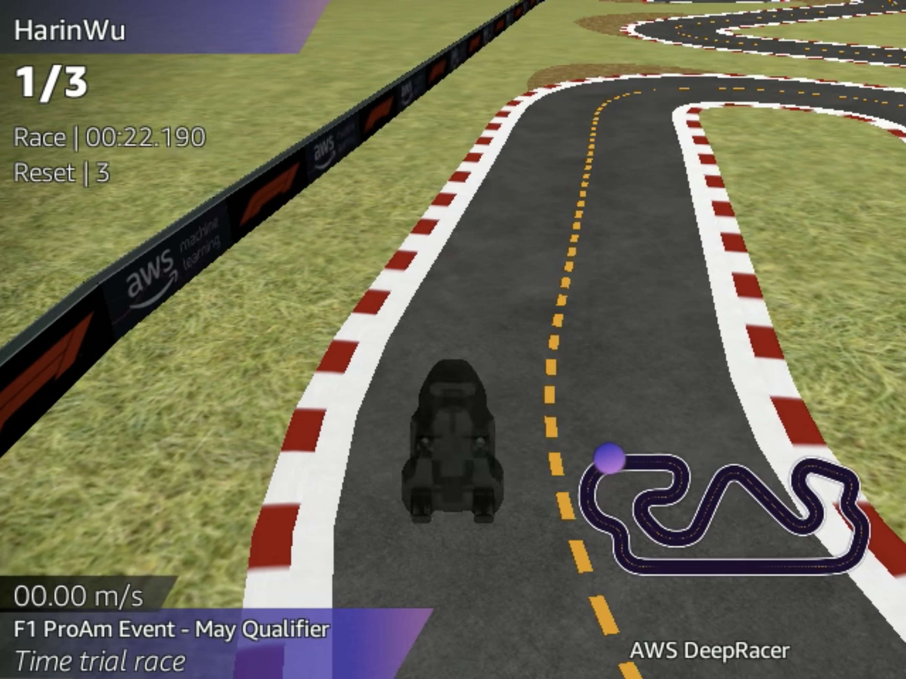

# Da Teoria à Pista

## Aprendizagem por Reforço com AWS DeepRacer

Como um agente aprende a tomar decisões? Como uma função de recompensa influencia seu comportamento? E como podemos descobrir por que um modelo apresenta bons ou maus resultados?

Este guia explora essas questões por meio do **AWS DeepRacer**, conectando os fundamentos teóricos da Aprendizagem por Reforço (*Reinforcement Learning* — RL) à experimentação prática, à análise de dados e à otimização de modelos.

O objetivo não é apenas treinar um carro para completar uma pista, mas compreender **como o agente aprende, como suas decisões são influenciadas pelas recompensas e como avaliar seu comportamento com base em evidências**.

[Começar pelo guia](introducao.md){ .md-button .md-button--primary }
[Ver repositório no GitHub](https://github.com/labpei-ifpe-paulista/bia-deepracer){ .md-button }

---

## O que você vai encontrar

-   **Fundamentos teóricos**

    ---

    Compreenda os componentes do aprendizado por reforço, incluindo estados, observações, ações, recompensas, políticas e Processos de Decisão de Markov.

-   **Experimentação prática**

    ---

    Explore funções de recompensa em Python e investigue como diferentes configurações influenciam o comportamento dos agentes.

-   **Análise de resultados**

    ---

    Utilize logs, gráficos e métricas para investigar dificuldades de treinamento, avaliar o desempenho e formular hipóteses de melhoria.

-   **Otimização de modelos**

    ---

    Conheça os algoritmos PPO e SAC, os principais hiperparâmetros e as estratégias para conduzir experimentos de maneira sistemática.

## Percurso de aprendizagem

O conteúdo está organizado em cinco módulos progressivos. Se você está começando em Aprendizagem por Reforço, siga a sequência recomendada. Caso já conheça os fundamentos, pode consultar diretamente os módulos de otimização, análise ou experimentação.

-   **01 · Introdução ao DeepRacer**

    ---

    Conheça a plataforma, os conceitos iniciais de RL, as aplicações educacionais e as alternativas disponíveis para executar o ambiente.

    [Explorar introdução](introducao.md)

-   **02 · Fundamentos de RL**

    ---

    Entenda como o agente interage com o ambiente, como as recompensas orientam o aprendizado e como estados, ações e políticas se relacionam.

    [Estudar fundamentos](fundamentos-rl.md)

-   **03 · Otimização e Estratégia**

    ---

    Aprenda a construir funções de recompensa, compreender hiperparâmetros e investigar as diferenças entre PPO e SAC.

    [Explorar estratégias](otimizacao-e-estrategia.md)

-   **04 · Análise de Logs**

    ---

    Descubra como examinar os dados de treinamento, interpretar gráficos e investigar situações em que o comportamento do modelo não corresponde ao esperado.

    [Analisar modelos](analise-de-logs.md)

-   **05 · Desafios Práticos**

    ---

    Aplique os conceitos em quatro desafios progressivos, desde a conclusão consistente de uma pista até a otimização do desempenho.

    [Iniciar desafios](desafios.md)

## Como aproveitar o guia

Para obter mais proveito dos módulos, adote uma abordagem investigativa:

1. **Compreenda o objetivo.** Antes de treinar um modelo, identifique o comportamento desejado e os critérios utilizados para avaliá-lo.
2. **Experimente de maneira controlada.** Modifique a função de recompensa ou uma configuração por vez, sempre que possível, e registre suas hipóteses.
3. **Analise as evidências.** Compare as métricas e observe o comportamento do veículo para verificar se os resultados correspondem ao objetivo.

Ao longo do guia, você encontrará exemplos de código, tabelas de referência, explicações conceituais e exercícios práticos.

!!! info "Nota conceitual"
    Os exemplos apresentados ajudam a compreender os princípios de Aprendizagem por Reforço. O efeito de cada estratégia depende do algoritmo, da configuração e do ambiente utilizado.

!!! tip "Dica de experimentação"
    Registre as configurações e os resultados de cada treinamento. Uma pontuação maior não garante, isoladamente, que o agente esteja apresentando um comportamento melhor.

!!! warning "Atenção aos requisitos do ambiente"
    A disponibilidade dos algoritmos, das modalidades de corrida e dos recursos de treinamento depende da implementação utilizada. Consulte a documentação correspondente antes de iniciar os experimentos.

## Ambiente de execução

O AWS DeepRacer passou por uma mudança importante em dezembro de 2025, quando o serviço gerenciado tradicional deixou de estar disponível no console da AWS. Atualmente, o guia contempla a solução oficial DeepRacer on AWS e alternativas desenvolvidas pela comunidade.

Você pode explorar as seguintes opções:

-   **DeepRacer on AWS**

    ---

    Solução oficial implantada na própria conta AWS, com recursos de treinamento e avaliação.

    [Consultar documentação oficial](https://docs.aws.amazon.com/solutions/latest/deepracer-on-aws/)

-   **DeepRacer for Cloud**

    ---

    Ambiente comunitário baseado em Docker, com opções de execução local e em infraestrutura de nuvem compatível.

    [Consultar repositório](https://github.com/aws-deepracer-community/deepracer-for-cloud)

-   **DeepRacer on the Spot**

    ---

    Ferramenta comunitária de automação de treinamento em nuvem, incluindo o uso de instâncias EC2 Spot.

    [Consultar repositório](https://github.com/aws-deepracer-community/deepracer-on-the-spot)

A escolha depende dos recursos computacionais, das permissões disponíveis e dos custos envolvidos.

Para acompanhar os conceitos, é importante conhecer Python e lógica de programação. A execução prática pode exigir também Git, Docker, familiaridade com o terminal e uma conta AWS, dependendo da alternativa escolhida.

[Conhecer os requisitos e as opções de acesso](introducao.md)

## Sobre o projeto

**Da Teoria à Pista: AWS DeepRacer como Facilitador do Ensino de Aprendizagem por Reforço** é um projeto desenvolvido durante minha atuação como bolsista BIA no curso de Análise e Desenvolvimento de Sistemas do Instituto Federal de Educação, Ciência e Tecnologia de Pernambuco (IFPE), Campus Paulista.

Sob orientação de Rodrigo Cesar Lira da Silva, o trabalho teve como objetivo investigar o uso do DeepRacer como ferramenta educacional para aproximar os estudantes dos conceitos de Aprendizagem por Reforço.

Entre as atividades desenvolvidas estão o estudo dos fundamentos teóricos, a criação e experimentação de modelos, a produção de materiais didáticos e a investigação de alternativas de execução diante das mudanças na plataforma.

O projeto foi apresentado no CONIC e resultou neste guia, que reúne o conteúdo desenvolvido para apoiar estudantes e desenvolvedores interessados em explorar o aprendizado por reforço.

A proposta é oferecer uma base de estudo e experimentação, incentivando a análise crítica dos resultados e o reconhecimento das limitações de cada abordagem. As recomendações do guia não substituem a documentação oficial nem dispensam a validação experimental.