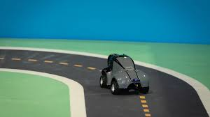

# Guia DeepRacer: Introdução

Este guia apresenta o AWS DeepRacer como uma ferramenta facilitadora para o aprendizado por reforço (Reinforcement Learning — RL). O objetivo é conectar os conceitos teóricos de Inteligência Artificial à experimentação prática, permitindo compreender como um agente aprende a tomar decisões em um ambiente simulado.

O conteúdo está estruturado em cinco módulos progressivos:

**Introdução ao DeepRacer**: Apresenta o aprendizado por reforço, a plataforma DeepRacer, suas aplicações educacionais e as alternativas disponíveis para executar o ambiente atualmente.

**Conceitos Fundamentais de Aprendizagem por Reforço**: Explora os fundamentos de RL e sua aplicação ao controle de veículos autônomos, incluindo estados, observações, ações, recompensas e políticas.

**Otimização e Estratégias**: Aborda a construção de funções de recompensa, a configuração de hiperparâmetros e as diferenças entre os algoritmos de aprendizado utilizados no DeepRacer.

**Análise de Logs e Gráficos**: Apresenta ferramentas que permitem investigar o comportamento dos modelos, interpretar resultados de treinamento e identificar oportunidades de melhoria.

**Desafios Práticos**: Propõe exercícios progressivos para aplicar os conceitos estudados, desenvolver modelos e analisar seu desempenho.

## O que é Aprendizagem por Reforço (RL)?

Dentro da Inteligência Artificial, o Aprendizado de Máquina (Machine Learning — ML) reúne técnicas que permitem a sistemas computacionais identificar padrões e melhorar seu desempenho a partir de dados e experiências.

Uma dessas técnicas é a Aprendizagem por Reforço, na qual um agente aprende a tomar decisões por meio da interação com um ambiente. Em vez de receber instruções explícitas para cada situação, ele experimenta ações e utiliza as recompensas recebidas para aprender comportamentos que favoreçam seus objetivos.

O funcionamento básico ocorre por meio de um ciclo:

1. O agente recebe uma observação do ambiente, como uma imagem da pista capturada por uma câmera.
2. Com base nas informações disponíveis, o agente seleciona e executa uma ação, como acelerar ou alterar a direção.
3. O ambiente reage à ação e produz uma nova situação.
4. Uma função de recompensa atribui um valor numérico ao comportamento observado.
5. O algoritmo utiliza as experiências acumuladas durante o treinamento para atualizar a política do agente.

Esse processo se repete ao longo do treinamento. Com o tempo, o agente pode aprender estratégias que aumentem a recompensa cumulativa esperada, considerando não apenas os resultados imediatos, mas também as consequências de suas decisões futuras.

### Recompensa e Aprendizado

A recompensa é um sinal numérico utilizado para orientar o aprendizado. Seu valor é definido pela função de recompensa, um trecho de código escrito em Python no DeepRacer.

Essa função traduz o objetivo desejado em critérios que o algoritmo consegue utilizar durante o treinamento. Por exemplo, um modelo pode receber recompensas por permanecer na pista e progredir ao longo do percurso, enquanto comportamentos indesejados podem receber valores menores.

!!! info "Nota conceitual"
    É importante compreender que a recompensa não representa necessariamente uma medida direta da qualidade real do comportamento. O agente aprende a maximizar o objetivo matemático definido pela função. Se os incentivos forem inadequados, ele poderá encontrar estratégias que aumentem a recompensa sem produzir o resultado esperado.

Por isso, desenvolver um bom modelo exige não apenas escrever uma função de recompensa, mas também observar o comportamento resultante e avaliar se ele corresponde ao objetivo pretendido.

## O que é o AWS DeepRacer?

O AWS DeepRacer é uma plataforma educacional desenvolvida pela Amazon Web Services (AWS) para facilitar o aprendizado de Aprendizagem por Reforço por meio de corridas de veículos autônomos.

A plataforma foi concebida em torno de um veículo de corrida em escala 1:18 e de um simulador 3D que permite treinar modelos de RL em pistas virtuais. O agente aprende a controlar o veículo de acordo com uma política desenvolvida durante o treinamento.

A simulação permite experimentar diferentes funções de recompensa, configurações de ação e hiperparâmetros sem depender da disponibilidade de um carro físico para cada treinamento.

O DeepRacer torna conceitos abstratos mais concretos. Em vez de analisar apenas números e equações, o estudante pode observar o veículo saindo da pista, fazendo curvas de maneira inadequada ou apresentando comportamentos diferentes após alterações no modelo.

Essa relação entre código, treinamento e comportamento observado oferece um contexto prático para compreender como as decisões de modelagem influenciam os resultados de um agente de Aprendizagem por Reforço.

## O estado atual do DeepRacer

Em 15 de dezembro de 2025, o AWS DeepRacer como serviço deixou de estar disponível no console tradicional da AWS. A plataforma passou a ter como alternativa oficial o **DeepRacer on AWS**, uma solução de código aberto que pode ser implantada e operada na própria conta AWS do usuário.

A mudança alterou a maneira de acessar e administrar o ambiente. No modelo anterior, grande parte da infraestrutura era gerenciada pela AWS como parte do serviço. Na solução atual, o usuário precisa implantar a arquitetura, configurar os acessos e acompanhar os recursos e custos associados à execução.

Isso não significa que todos os componentes da infraestrutura precisem ser administrados manualmente. A solução utiliza serviços gerenciados da AWS, mas sua implantação e operação exigem mais responsabilidade do usuário.

O projeto oficial mantém recursos para treinamento e avaliação de modelos, simulação e organização de corridas. Entretanto, os recursos disponíveis, os procedimentos de configuração e as modalidades de corrida devem ser conferidos na documentação correspondente à solução e à versão utilizada.

A disponibilidade comercial de veículos físicos também mudou: a AWS informou que os dispositivos DeepRacer deixariam de ser vendidos em Amazon.com a partir da mesma data. Portanto, este guia prioriza a utilização do ambiente simulado, que não depende da aquisição de um veículo físico.

Documentação oficial: [DeepRacer on AWS](https://docs.aws.amazon.com/solutions/latest/deepracer-on-aws/).

### Considerações de custos ao executar na AWS

!!! warning "Atenção aos Custos na AWS"
    Ao utilizar a solução oficial, os recursos são provisionados na sua própria conta AWS. Dependendo da configuração, podem existir custos relacionados a serviços como Amazon SageMaker, Amazon S3 e outros componentes utilizados pela arquitetura.

O custo final depende dos recursos provisionados, da região selecionada, do tempo de utilização e das configurações adotadas. Por isso, não é adequado presumir que a execução será gratuita ou que terá o mesmo custo para todos os usuários.

Antes da implantação:

- Consulte os requisitos e os custos dos recursos utilizados.
- Verifique as permissões necessárias para criar e administrar a infraestrutura.
- Acompanhe o uso dos serviços durante os experimentos.
- Ao concluir os testes, interrompa ou remova os recursos que não serão mais utilizados, seguindo os procedimentos oficiais de limpeza da implantação.

Esses cuidados são especialmente importantes em ambientes acadêmicos com limites de orçamento, permissões restritas ou cotas de utilização.

### Como acessar o DeepRacer atualmente

Existem diferentes alternativas para utilizar o DeepRacer. A escolha depende dos recursos disponíveis, da familiaridade com infraestrutura e das condições de execução do treinamento.

---

#### Forma oficial: DeepRacer on AWS

**[AWS Solutions — DeepRacer on AWS](https://docs.aws.amazon.com/solutions/deepracer-on-aws/)**

A solução oficial permite implantar a arquitetura do DeepRacer na própria conta AWS utilizando os recursos e procedimentos documentados pela AWS.

Essa alternativa oferece uma experiência integrada de treinamento e avaliação, mas exige uma conta AWS, permissões compatíveis com a implantação e atenção aos custos dos serviços provisionados.

A implantação não deve ser considerada automaticamente compatível com ambientes acadêmicos restritos. Antes de iniciar, verifique se a conta disponível permite criar os recursos exigidos pela solução.

---

#### Alternativa da comunidade: DeepRacer for Cloud (DRFC)

**[Repositório do DeepRacer for Cloud](https://github.com/aws-deepracer-community/deepracer-for-cloud)**

O DeepRacer for Cloud é um projeto comunitário que disponibiliza um ambiente de treinamento baseado em contêineres Docker. Ele pode ser executado localmente ou em infraestrutura de nuvem compatível, conforme os requisitos da versão utilizada.

O treinamento local pode reduzir a dependência de recursos computacionais pagos na AWS, mas exige hardware adequado, configuração do ambiente e instalação das dependências necessárias.

A execução em nuvem permite utilizar recursos computacionais sob demanda, porém continua sujeita aos custos de infraestrutura e à disponibilidade das instâncias selecionadas.

---

#### Alternativa da comunidade: DeepRacer on the Spot (DOTS)

**[Repositório do DeepRacer on the Spot](https://github.com/aws-deepracer-community/deepracer-on-the-spot)**

O DeepRacer on the Spot é um projeto comunitário voltado à automação do treinamento utilizando o DeepRacer for Cloud e recursos de computação em nuvem, incluindo instâncias EC2 Spot.

As instâncias Spot podem oferecer custos inferiores aos de instâncias sob demanda, mas sua disponibilidade pode ser interrompida pela AWS. A economia efetiva depende da configuração, do tempo de execução, da disponibilidade dos recursos e dos demais serviços utilizados.

Antes de adotar essa alternativa, consulte a documentação do projeto para verificar os requisitos, o estado de manutenção e a compatibilidade com seu ambiente.

!!! warning "Atenção aos requisitos do ambiente"
    as alternativas descritas não são necessariamente intercambiáveis em todos os aspectos. Diferenças de configuração, implementação e versão podem afetar os algoritmos disponíveis, as modalidades de corrida, o acesso aos modelos e os procedimentos de análise.

## Por que usar o DeepRacer para aprender?

### Foco na função de recompensa

O DeepRacer fornece um ambiente especializado para experimentar conceitos de Aprendizagem por Reforço sem exigir que o estudante desenvolva do zero todo o simulador, o sistema de treinamento e a infraestrutura de controle do veículo.

Isso permite concentrar parte significativa dos estudos na função de recompensa e na observação do comportamento do agente.

Ao modificar os incentivos e avaliar o comportamento resultante, o estudante pode investigar como a definição de um objetivo influencia o aprendizado. O exercício também demonstra os limites dessa abordagem: uma função de recompensa mal definida pode incentivar comportamentos inesperados, mesmo quando o algoritmo está funcionando conforme projetado.

### Feedback visual

Interpretar apenas métricas numéricas pode ser difícil para quem está começando. O simulador 3D oferece uma representação visual do comportamento aprendido.

Se o modelo apresentar dificuldades em curvas, sair da pista ou executar movimentos instáveis, esses comportamentos podem ser observados durante a avaliação e investigados por meio dos dados de treinamento.

O feedback visual facilita a formulação de hipóteses sobre o desempenho do modelo, mas não substitui a análise quantitativa. Uma volta aparentemente boa não garante que o agente seja consistente, rápido ou capaz de lidar com outras condições.

### Experimentação controlada

O ambiente permite modificar configurações e comparar modelos treinados sob condições definidas.

Por exemplo, é possível investigar como diferentes funções de recompensa afetam a capacidade de completar uma pista ou como alterações no espaço de ação influenciam a trajetória do veículo.

!!! tip "Dica de experimentação"
    Para que essas comparações tenham valor, é importante registrar as configurações utilizadas, observar os critérios de avaliação e evitar atribuir uma melhoria a determinada alteração sem considerar outras diferenças entre os experimentos.

### Relação entre computação em nuvem e aprendizado de máquina

O DeepRacer também oferece uma oportunidade de conhecer ferramentas e conceitos de computação em nuvem relacionados ao treinamento de modelos.

Na solução oficial, o treinamento utiliza serviços como Amazon SageMaker, enquanto o armazenamento de dados e artefatos pode envolver Amazon S3. A infraestrutura necessária depende da alternativa de execução escolhida.

A nuvem pode facilitar o acesso a recursos computacionais, mas não elimina a necessidade de compreender permissões, limites de utilização, custos e requisitos operacionais.

## Próxima etapa

[Fundamentos de Aprendizagem por Reforço](fundamentos-rl.md)